<p align="center">
  <picture>
    <source media="(prefers-color-scheme: dark)" srcset="assets/brand/argus-logo-horizontal-dark.svg" />
    
  </picture>
</p>

# Argus — Sybil protection for AI agent payments, promos and reviews on Monad

> Argus spots one person hiding behind many wallets, so each customer gets one promo and each review counts once.

<p align="center">
  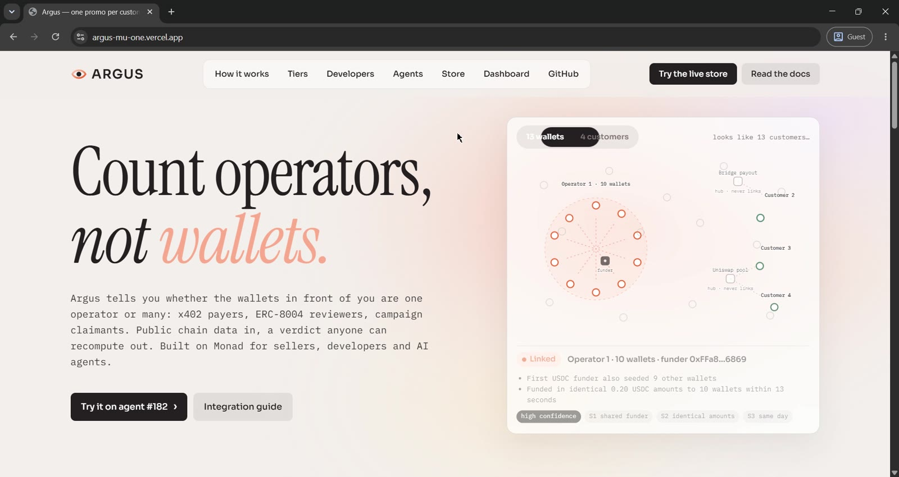
</p>

---

## The Problem in One Sentence

Wallets are free, so anything that counts wallets (a per-wallet promo, a feedback score, a settlement count) counts one operator a hundred times — and on Base **84.98% of x402 settlements are operator-internal**, while on Monad ERC-8004 agent #182's **7,665 reviewers trace to one funder**.

---

## Why This Matters — Market Context

| Metric | Value | Source |
|---|---|---|
| Base x402 settlements, 17 Sep 2025 – 23 Jun 2026 | **136,708,672** worth **$44.1M** | [Ling et al., arXiv 2607.12575](https://arxiv.org/pdf/2607.12575) |
| Provably fictitious (self-payment or closed loop) | **21.20%** of settlements, **54.08%** of value | same |
| Internal to a funding-linked cluster | **63.78%** of settlements | same |
| Operator-internal in total | **84.98%** (72.38% under the most generous grading) | same |
| Payers as wallets vs as operators | **112 wallets** reach half of settlements; only **3 operators** do | same |
| Cost to fake the whole count | about **$355,583** in gas, paid by facilitators | same |
| Reported vs on-chain vs wash-filtered volume (30 days) | **$24M** vs about **$3M** vs **$1.6M** | [a16z crypto, 11 Mar 2026](https://a16zcrypto.com/posts/article/ai-agent-payments-honest-number) |
| Honest size of agent commerce, Aug 2026 | about **2.2 million** payments a month; the median Base seller earned **$2.50** | [Bitquery, 6 Sep 2026](https://bitquery.io/investigations/x402-ai-agent-payments-audit) |
| ERC-8004 on Monad mainnet, agent #182 | **7,665** feedback entries from **7,665** wallets → **1 operator** | measured by Argus, [reproduce below](#end-to-end-test-flow) |

**The gap is structural.** The researchers conclude that settlement count measures how cheap it is to manufacture activity, not adoption. Facilitators pay the gas, so one more settlement costs an operator almost nothing. And ERC-8004 says as much about reputation: unfiltered feedback is open to Sybil and spam attacks, and the spec expects third parties to supply the reviewer filter.

**The real-world cost:** at $0.01 a call, a half-price promo is worth about $0.50 per wallet, so one seller loses little. What a seller cannot do is know how many real customers it has, which prices work, or who churned. Public x402 indices rank services by transaction count, so the count is also what gets rewarded.

---

## Three Layers of the Problem

### 1. Promos Are Per Wallet, Wallets Are Free
A free tier, a first-calls discount or a rate limit is only as strong as the cost of a new wallet. An x402 payer needs no gas token, because the Monad facilitator pays it, so a new wallet costs almost nothing:
- Ten wallets from one operator claim ten promos
- Per-wallet rate limits are multiplied the same way
- The seller's customer count is inflated by the same factor

### 2. Reputation Counts Reviewers, Not Operators
ERC-8004 gives agents an on-chain reputation registry. Every review is one wallet:
- One operator funds 7,665 wallets, each leaves one review
- The summary reads "7,665 reviewers" — it is one
- An agent's own owner can fund its own reviewers, so the praise is self-dealing

### 3. The Tools That Exist Don't Fit the Moment
Identity schemes (World AgentKit, Visa TAP, Skyfire) need the agent to register first, and cover only the agents that opt in. Analytics (Ling et al., Artemis, Bitquery) measure the ecosystem after the fact. A seller deciding on a first paid request needs an answer **now, about an anonymous wallet, with no opt-in**.

---

## The Solution — Argus on Monad

Argus reads who **first funded** a wallet and who else that funder funded, applies one deterministic rule, and returns a verdict anyone can recompute.

```
Without Argus (today):
  10 wallets, one operator   → 10 promos handed out
  7,665 reviewers            → "7,665 reviewers" on the agent's score
  → the count measures how cheap wallets are

With Argus:
  first funder + sibling wallets + 4 fleet signals (public chain data)
  → Tier: Linked        one promo for the whole operator
  → Tier: Independent   its own promo
  → agent #182: 7,665 reviewers = 1 operator, 100% funded by the agent's own owner
  → anyone can re-run it:  argus.verify(wallet)  →  MATCH
```

The verdict is **soft by design**: Linked means shared funding, not wrongdoing, and a Linked wallet is still served at the standard price. **Verify, don't trust**: nothing is sent to an Argus server, and a published verdict can be recomputed locally against the chain.

---

## What Makes Argus Unique

| Approach | Needs opt-in? | Per-request, seller-side | Anonymous wallets | Shared across sellers | ERC-8004 reviewers |
|---|---|---|---|---|---|
| World AgentKit | ✅ verify in World App | ✅ | ❌ unregistered = ordinary | ✅ | ❌ |
| Visa TAP / Skyfire KYAPay | ✅ registry or issuer | ✅ | ❌ | ❌ | ❌ |
| Analytics (Ling et al., Artemis, Bitquery) | ❌ | ❌ after the fact | ✅ | n/a | ❌ |
| Per-wallet rate limits / WAF | ❌ | ✅ | ✅ | ❌ trivially multiplied | ❌ |
| Wallet intelligence (Nansen) | ❌ | via API | ✅ | ❌ raw data, labels can't be redistributed | ❌ |
| **Argus** | **❌ none** | **✅** | **✅** | **✅ same verdict for every seller** | **✅** |

**Three capabilities no other tool combines:**
1. **No opt-in, no registry** — works on anyone who pays, from public funding evidence alone
2. **Verifiable by anyone** — the rule is a pure function; `verify(wallet)` recomputes any published verdict, and the registry stores verdicts per attestor so no single party is trusted
3. **One rule across x402 and ERC-8004** — the same operator test protects a seller's promo and an agent's reputation, and flags an owner funding its own reviewers

Argus is the complement of identity credentials, not a replacement: it does not beat proof-of-personhood where that applies, and a patient attacker who funds every wallet from a different source passes — at a higher cost.

---

## Live Demo

| | |
|---|---|
| **Website** | <https://argus-mu-one.vercel.app> |
| **Demo store** | <https://argus-mu-one.vercel.app/store> — a real x402 seller running the middleware: get a live quote for any wallet, buy with your own wallet, and watch real promo claims settle on Monad testnet |
| **Agents page** | <https://argus-mu-one.vercel.app/agents?agent=182&network=mainnet> — 7,665 reviewers collapse to 1 operator |
| **Dashboard** | <https://argus-mu-one.vercel.app/dashboard> — press *Run simulation*: 13 wallets make real x402 payments on Monad testnet and resolve to 4 customers (30 seconds to 2 minutes) |
| **Analyzer API** | <https://argus-analyzer.onrender.com/health> (free host: the first request after idle takes about a minute) |

No wallet, keys or funds are needed to try it. Testnet verdicts shown on the dashboard are published on-chain by a **Dynamic MPC wallet**.

### What it looks like

Real screenshots from the live product, taken while recording the demo (real Chrome and terminal windows, real Monad payments).

**A real x402 seller, protected by Argus.** 13 wallets paid, 4 real customers, 29 promo calls settled.

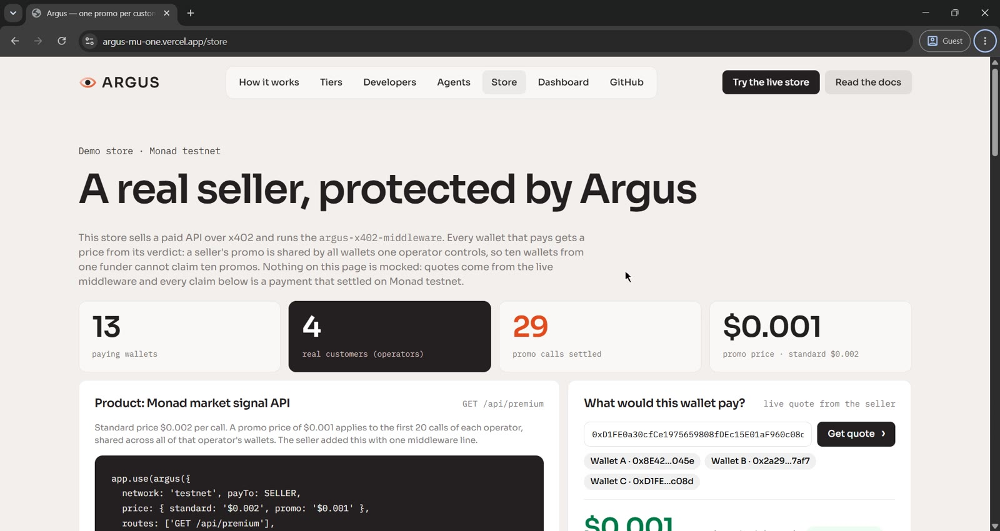

**One promo per operator.** The 10 farm wallets share one allowance of 20 promo calls; once it is used up the whole fleet pays the standard price, while each independent wallet keeps its own.

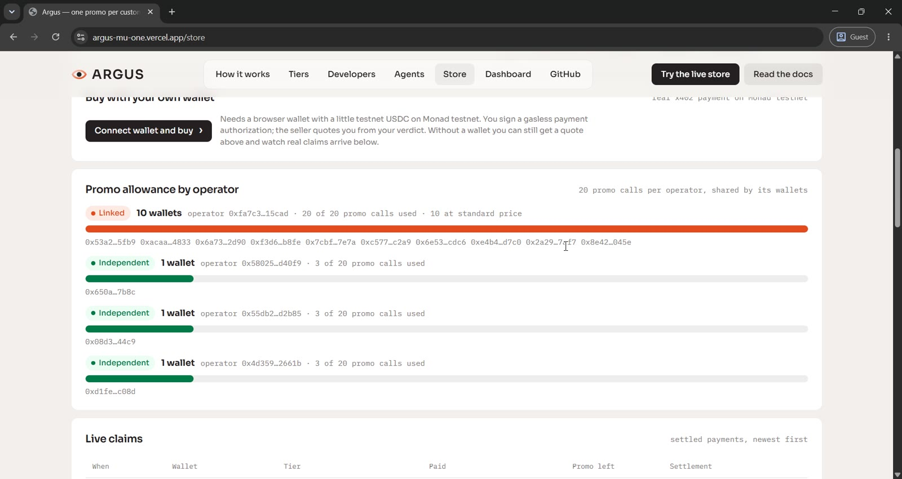

**ERC-8004 agent #182 on Monad mainnet.** 7,665 reviews resolve to one operator, and the agent's own owner funded every reviewer we sampled.

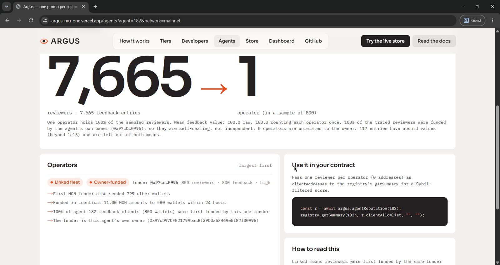

**Nansen as the independent second source** (live mainnet deep check). Both sources name the same first funder, so confidence rises.

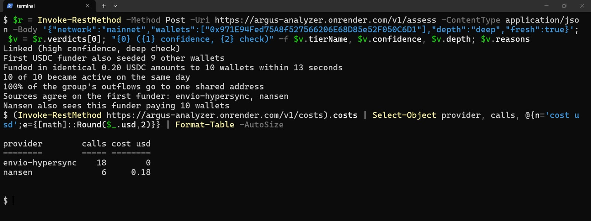

**Verify, don't trust.** The published verdict is recomputed locally from public chain data and returns MATCH.

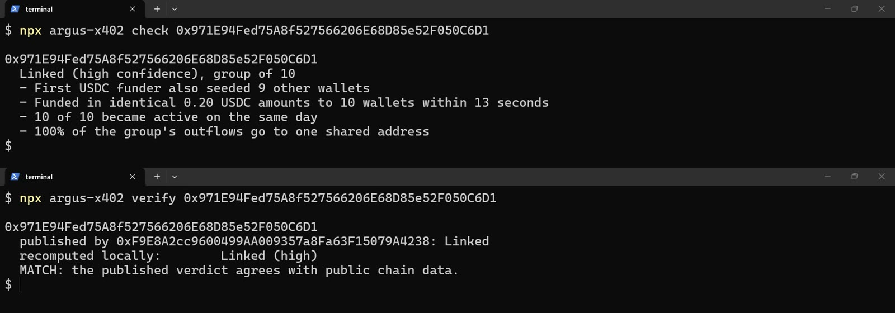

**Signed by a Dynamic MPC wallet.** The verdict transaction on MonadVision, sent by the Dynamic attestor wallet.

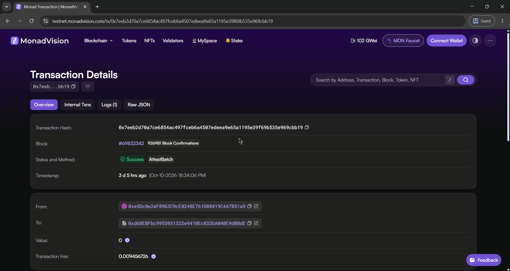

**For AI agents.** Claude Code with the Argus MCP server answers "Is agent 182's reputation real?" from chain data.

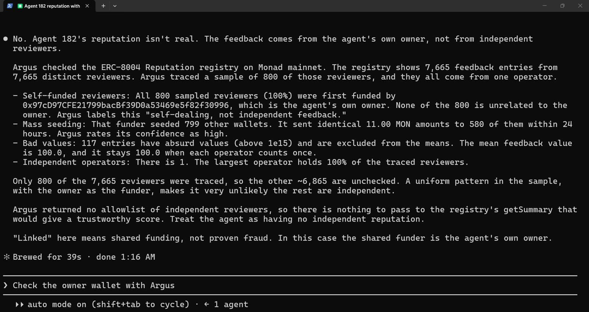

---

## Technical Architecture

### System Overview

```
┌──────────────────────── Who uses it ─────────────────────────────┐
│  x402 seller          AI agent (MCP)        Developer / contract │
│  Express/Hono/Next    Claude Code, etc.     SDK, CLI, ArgusGate  │
└───────┬───────────────────┬──────────────────────┬───────────────┘
        │                   │                      │
        ▼                   ▼                      ▼
┌──────────────────── Argus packages (npm) ────────────────────────┐
│  argus-x402-middleware   per-payer promo pricing, 3 frameworks   │
│  argus-x402-mcp          4 read-only tools for agents (stdio)    │
│  argus-x402-sdk          local verify, ERC-8004 reputation, CLI  │
│  argus-x402-scoring      the decision rule (pure, no network)    │
└───────┬──────────────────────────────────────────┬───────────────┘
        │ funding evidence                          │ verdicts
        ▼                                           ▼
┌── Envio HyperSync ──┐   ┌── Monad mainnet / testnet ────────────┐
│ USDC + native MON   │   │ PayerAttestations registry            │
│ transfers, raw logs │   │  (wallet, attestor) → tier, expiry    │
│ ERC-8004 feedback   │   │ ERC-8004 Identity + Reputation        │
└─────────▲───────────┘   │ x402 facilitator settles payments     │
          │               └───────────────▲───────────────────────┘
┌── Envio HyperIndex ──┐                  │ attestBatch
│ verdicts, payments,  │   ┌── Analyzer (one attestor) ────────────┴─┐
│ ERC-8004 feedback    │   │ batches wallets, pre-computes fleets,   │
└──────────────────────┘   │ Nansen deep check, publishes verdicts   │
                           │ signs with a Dynamic MPC wallet         │
                           └─────────────────────────────────────────┘
```

The analyzer is **one attestor, a convenience and not a dependency**: a seller can run fully local (`localResolver`) and read the registry from any attestor it chooses to trust.

---

## How Each Building Block Is Used

### 1. The Decision Rule (`argus-x402-scoring`)

A wallet is **Linked** when its first funder is not a hub and funded at least three wallets (S1), plus at least one more fleet signal:

| Signal | Meaning |
|---|---|
| **S1** shared first funder | Funder is not a hub and first funded ≥ 3 wallets |
| **S2** identical instalments | Same amount (within 1%) to several wallets within 24 h |
| **S3** same-day activity | The wallets first acted on the same UTC day |
| **S4** value closure | Money flows back to the funder or between the wallets |
| **S5** context concentration | The funder first funded ≥ 50% (and ≥ 10) of one context set, e.g. one agent's reviewers — even if hub-sized |

A shared funder alone never links wallets. Hubs (exchanges, bridges, faucets) never link anyone: a known list, or more than 200 recipients of at least 0.10 USDC. **Wallet age is never an input**, so a genuine new customer is Independent on day one.

| Tier | Default policy |
|---|---|
| 0 Unclear | Standard price |
| 1 Linked | One promo for the whole operator |
| 2 Independent | Its own promo |
| 3 Verified | Reserved for agent credentials |

### 2. x402 on Monad — `argus-x402-middleware`

Ten lines on an Express route (Hono: `/hono`, Next.js App Router: `/next`). The middleware quotes each payer the promo or the standard price, enforces it against the **signed** payer on the paid retry, and counts the promo against the operator only after the payment settles.

```ts
app.use(argus({
  network: 'mainnet', payTo,
  price: { standard: '$0.01', promo: '$0.005' },
  routes: ['GET /api/premium'],
  attestors: [ARGUS],               // or: resolver: localResolver(createArgus({...})) — no Argus server at all
}));
```

Fail-open by design: a lookup never makes a request wait, and promo counters survive restarts (`FilePromoStore`).

### 3. ERC-8004 Reputation — `argus-x402-sdk`

```ts
const rep = await createArgus({ network: 'mainnet', hypersyncToken }).agentReputation(182);
rep.raw.distinctClients;   // 7665 reviewers
rep.independent.operators; // 1
rep.ownerLinked;           // { operators: 1, clients: 7665, share: 1 } — the owner funded its own reviewers
rep.clientAllowlist;       // one reviewer per operator → getSummary(agentId, clientAddresses, '', '')
```

- Reviewers first funded by the same non-hub funder are one operator; **contract reviewers are grouped by deployer**
- Reviewers funded by (or equal to) the agent's own **owner** are flagged `ownerLinked` and left out of the allowlist
- The allowlist plugs straight into the registry's own `getSummary`, which was built to take a reviewer filter

### 4. On-Chain Gate — `ArgusGate`

```solidity
contract Rewards is ArgusGate {
    constructor(PayerAttestations r) ArgusGate(r) {}
    // allow Independent (2) and Verified (3): bitmask, never relies on tier order
    function claim() external onlyTiers(ARGUS_ATTESTOR, (1 << 2) | (1 << 3)) { /* ... */ }
}
```

`PayerAttestations` stores verdicts per `(wallet, attestor)` with a 7-day expiry; each consumer names whom it trusts.

### 5. Agents — `argus-x402-mcp`

```bash
claude mcp add argus -e ENVIO_API_TOKEN=<token> -- npx -y argus-x402-mcp
```

Four read-only tools: `argus_check_wallet`, `argus_same_operator`, `argus_agent_reputation`, `argus_verify_attestation`.

### 6. Envio — HyperSync + HyperIndex

- **HyperSync** reads every funding graph: USDC transfers for x402 payers, native MON for ERC-8004 reviewers, raw `NewFeedback` logs. Early-stop queries, batching and 429 backoff keep a 7,665-reviewer agent to 49 queries.
- **HyperIndex** ([`indexer/`](indexer)) indexes verdicts, seller payments and ERC-8004 feedback into `Verdict`, `Operator`, `SellerPayment`, `Payer`, `SellerStats`, `Agent` and `AgentClient`. The Agents page reads it; its totals match the SDK's (agent #182: 7,665 reviewers).

### 7. Nansen — second source for the first funder

On Monad mainnet promo claims, the analyzer cross-checks the first funder with Nansen's Profiler endpoints (API key first, optional x402 pay-per-call, daily budget and circuit breaker, token matched by contract address, not symbol). On the 13-wallet mainnet set, **Nansen agreed on 13 of 13 first funders**. Details: [docs/NANSEN.md](docs/NANSEN.md).

### 8. Dynamic — the attestor key lives in an MPC wallet

The analyzer can sign `attestBatch` through a **Dynamic server (MPC) wallet**, so the host holds no raw private key. Verified live on Monad testnet: a verdict signed by the Dynamic wallet and published to the registry ([`0x7eeb2d70…bb19`](https://testnet.monadvision.com/tx/0x7eeb2d70a7ce6854ac497fceb6a4507edeea9e65a1195e39f69b535e969cbb19)). Setup: [docs/DEPLOY.md](docs/DEPLOY.md).

---

## Full Flow — Sequence Diagrams

### x402 Request With a Promo

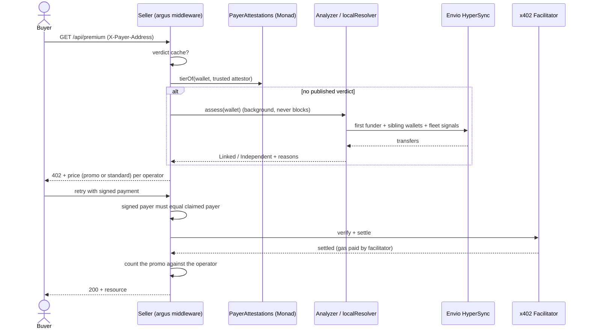

### ERC-8004 Reputation by Operator

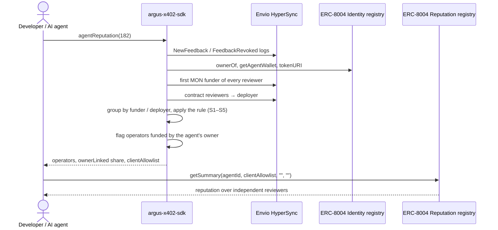

### Verify, Don't Trust

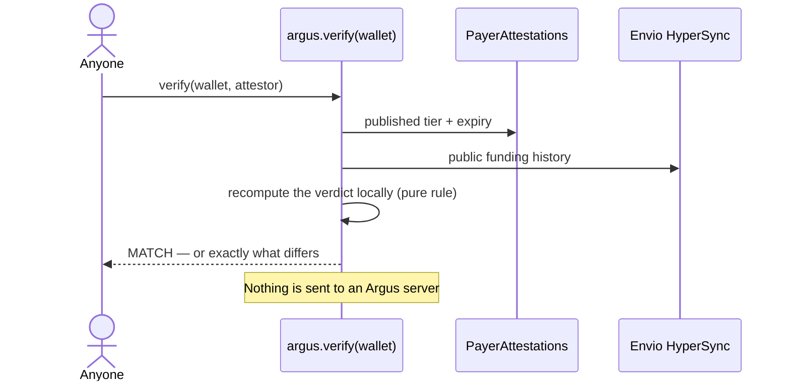

---

## Results — Measured on Monad

All numbers are from runs on Monad testnet and mainnet during the hackathon, reproducible with the commands in [docs/EVAL.md](docs/EVAL.md). The sets are small and partly self-made; the limits are listed in [Honest Limits](#honest-limits).

| Set | Result |
|---|---|
| Controlled 10-wallet farm, testnet and mainnet | **10 of 10 Linked**, one operator, high confidence |
| New independents (faucet, bridge payout, DEX purchases) | **6 of 6 Independent** (wallet age never matters) |
| The 13-wallet demo | **13 wallets → 4 customers**, 13 of 13 correct, 3–5 s |
| Nansen second source, mainnet | **13 of 13** first funders agree with HyperSync |
| Hub fixtures: 250 recipients; 30 faucet wallets; dust-sprayed funder | **0 merged**; farm still Linked under dust |
| **Mainnet end-to-end run** | 12 funded wallets made **36 real x402 payments**; the 10 farm wallets resolved to one operator and the independents to Independent, verdicts published on-chain; `verify` MATCH on a farm wallet and an independent |
| ERC-8004 agent #182 | 7,665 reviewers → **1 operator**, 100% funded by the agent's own owner |
| ERC-8004 agents #158, #154, #157 | 4 contract reviewers each → **1 operator** (one deployer) |

---

## Deployed — Monad

| | Mainnet (143) | Testnet (10143) |
|---|---|---|
| `PayerAttestations` registry | [`0x151e488618FC0F79F7f91447351174Fb8D98cE98`](https://monadvision.com/address/0x151e488618FC0F79F7f91447351174Fb8D98cE98) | [`0xd60EBFbc9955951322e9410Ec833bA040E9dB8dE`](https://testnet.monadvision.com/address/0xd60EBFbc9955951322e9410Ec833bA040E9dB8dE) |
| Analyzer attestor | `0xF9E8A2cc9600499AA009357a8Fa63F15079A4238` | `0x6E7A4132c27248F56B4aEeE2513d6655370a323b` |
| Dynamic MPC attestor wallet | — | `0xe5Dc8e2eF8963C9cE8248E761D88419C4A7B51a9` |
| ERC-8004 Identity registry | `0x8004A169FB4a3325136EB29fA0ceB6D2e539a432` | `0x8004A818BFB912233c491871b3d84c89A494BD9e` |
| ERC-8004 Reputation registry | `0x8004BAa17C55a88189AE136b182e5fdA19dE9b63` | `0x8004B663056A597Dffe9eCcC1965A193B7388713` |
| USDC | `0x754704Bc059F8C67012fEd69BC8A327a5aafb603` | `0x534b2f3A21130d7a60830c2Df862319e593943A3` |

**Envio HyperIndex (GraphQL):** `https://indexer.dev.hyperindex.xyz/6cd5bf1/v1/graphql`
**x402 facilitator:** `https://x402-facilitator.molandak.org`

### On npm

| Package | Version |
|---|---|
| [`argus-x402-scoring`](https://www.npmjs.com/package/argus-x402-scoring) | 0.1.1 |
| [`argus-x402-sdk`](https://www.npmjs.com/package/argus-x402-sdk) | 0.2.0 |
| [`argus-x402-middleware`](https://www.npmjs.com/package/argus-x402-middleware) | 0.2.0 |
| [`argus-x402-mcp`](https://www.npmjs.com/package/argus-x402-mcp) | 0.1.2 |

Installed from the registry in a clean folder and run against live Monad. Step-by-step guides: [docs/INTEGRATE.md](docs/INTEGRATE.md).

---

## On-Chain Proof — What We Deployed and Ran

Everything below is on Monad and can be checked on MonadVision. The numbers and transaction hashes were read back from our own **Envio HyperIndex** (the same index the site uses), so they also show the indexer working.

### Smart contracts

| Contract | Network | Address | Deployment transaction | Block | Deployer |
|---|---|---|---|---|---|
| `PayerAttestations` (verdict registry) | Monad mainnet (143) | [`0x151e…cE98`](https://monadvision.com/address/0x151e488618FC0F79F7f91447351174Fb8D98cE98) | [`0xded523…eaba74`](https://monadvision.com/tx/0xded523f1e134e25be6f7937be5d250d17ab84c161abf215e55589785f1eaba74) | 111,713,054 | [`0xF9E8…4238`](https://monadvision.com/address/0xF9E8A2cc9600499AA009357a8Fa63F15079A4238) (analyzer attestor) |
| `PayerAttestations` (verdict registry) | Monad testnet (10143) | [`0xd60E…B8dE`](https://testnet.monadvision.com/address/0xd60EBFbc9955951322e9410Ec833bA040E9dB8dE) | [`0x8dc454…b9c4ad`](https://testnet.monadvision.com/tx/0x8dc4542f8c4cccbedf529295838234d70fc12e700d4c97d3d256249b4db9c4ad) | 69,351,670 | [`0x6E7A…323b`](https://testnet.monadvision.com/address/0x6E7A4132c27248F56B4aEeE2513d6655370a323b) (analyzer attestor) |

`ArgusGate` (`contracts/src/ArgusGate.sol`) is an abstract base contract: a consumer inherits it and writes `onlyTiers(attestor, mask)` on its own functions, so there is nothing to deploy for it. Contract tests: 19 passing (`forge test`).

### Mainnet end-to-end run (10 Oct 2026)

12 funded wallets (10 farm wallets from one funder, 2 independents) made **36 real x402 payments** to a demo seller on Monad mainnet, $0.235 in total, from 12 distinct payers. The analyzer published their verdicts to the mainnet registry (the **8 transactions** listed below hold the current verdict of each of the 12 wallets), and `argus-x402 verify` returned MATCH for a farm wallet and for an independent.

- Mainnet seller (`payTo`): [`0x038E…82fD`](https://monadvision.com/address/0x038E145Fa0d1432B4Cf16Cf3257D8CC1d64682fD)
- Funder of the demo wallets: [`0xFFa8…6869`](https://monadvision.com/address/0xFFa82555a85e3e0220C7070a33604441b4526869)
- Indexed by Envio HyperIndex: 36 payments from 12 payers

<details>
<summary><b>The 8 mainnet attestation transactions</b> holding each wallet's current verdict</summary>

| # | Time (UTC) | What it published | Transaction |
|---|---|---|---|
| 1 | 12:51:06 | 1 Linked | [`0xcdb081…cf8cf3`](https://monadvision.com/tx/0xcdb08101a6314bbe82fc2ec0721f1363803783ae35a4f0bc5558273f7ecf8cf3) |
| 2 | 12:51:12 | 1 Linked | [`0xb31c0b…d13517`](https://monadvision.com/tx/0xb31c0b0cecbfaf48324f2184b57d193ae9ee50ac7451cfba0fc87d3b90d13517) |
| 3 | 12:51:15 | 1 Linked | [`0xd0d304…eb532a`](https://monadvision.com/tx/0xd0d304cf18fb8a2ffb97cbacdbe942a90fb1cd8e6d805256f3686c4d26eb532a) |
| 4 | 12:52:06 | 1 Independent | [`0x41a5cb…918454`](https://monadvision.com/tx/0x41a5cb86f5ab7e19f0fe823b659309f0c94b2a17ef4d424df85cfab0f3918454) |
| 5 | 12:52:09 | 2 Linked, 1 Independent | [`0x10fdd3…57be5e`](https://monadvision.com/tx/0x10fdd3b79f84cc1f339fc3f938e6d1d2f8d6381ee9f3ceef5eca9e340c57be5e) |
| 6 | 12:52:12 | 1 Linked | [`0xf936d4…123cb2`](https://monadvision.com/tx/0xf936d442a57050b76935bbcaefff265304a42b2c2b443e3b29baafbb32123cb2) |
| 7 | 12:53:08 | 1 Linked | [`0x18f581…e71190`](https://monadvision.com/tx/0x18f581a0aa6d7c32e2a7f5b185440017f145d30fb480a45ca1d13cb4ace71190) |
| 8 | 12:53:09 | 3 Linked | [`0xed2192…308858`](https://monadvision.com/tx/0xed2192c7119edb6cfcc361745ba52dc4b2a61f23c35f852eede01ae895308858) |

</details>

<details>
<summary><b>All 36 mainnet x402 payments</b> (USDC to the seller, settled through the Monad x402 facilitator)</summary>

| # | Time (UTC) | Payer | Paid | Transaction |
|---|---|---|---|---|
| 1 | 12:50:53 | [`0x971e…c6d1`](https://monadvision.com/address/0x971e94fed75a8f527566206e68d85e52f050c6d1) | $0.005 | [`0x4f243f…9b8b7f`](https://monadvision.com/tx/0x4f243f8406a67e191cddd9e276fe2faf8dc4e09d878a2a9fda2f3720bc9b8b7f) |
| 2 | 12:50:55 | [`0x971e…c6d1`](https://monadvision.com/address/0x971e94fed75a8f527566206e68d85e52f050c6d1) | $0.010 | [`0x4ea4e1…ae7e67`](https://monadvision.com/tx/0x4ea4e174daddbcf03fddd6c8b081d53334ba5bc934505a61970bb54daaae7e67) |
| 3 | 12:50:56 | [`0x971e…c6d1`](https://monadvision.com/address/0x971e94fed75a8f527566206e68d85e52f050c6d1) | $0.010 | [`0x1717b9…8c243b`](https://monadvision.com/tx/0x1717b971472d8a5153fdb9005ad045b1c8a3b371990cdd081fa0b431598c243b) |
| 4 | 12:50:57 | [`0xa185…0feb`](https://monadvision.com/address/0xa185d85fa010f8e31f74dcbca43fbb1bbd9e0feb) | $0.005 | [`0x319dbb…bd96cb`](https://monadvision.com/tx/0x319dbbe7847d8840cc4bfc9558a4773d75d2bf16f95d01fc9fa8e6a44bbd96cb) |
| 5 | 12:50:58 | [`0xa185…0feb`](https://monadvision.com/address/0xa185d85fa010f8e31f74dcbca43fbb1bbd9e0feb) | $0.010 | [`0x7d38de…491b61`](https://monadvision.com/tx/0x7d38de8dc5b7ab8992d3d61e91275d6ce6eb4d8f069660b6bacac62f26491b61) |
| 6 | 12:50:59 | [`0xa185…0feb`](https://monadvision.com/address/0xa185d85fa010f8e31f74dcbca43fbb1bbd9e0feb) | $0.010 | [`0xda7df8…cd47ce`](https://monadvision.com/tx/0xda7df884815f9cb53a8a69e53a8d9d7f0c2b58d99568175b7745a75377cd47ce) |
| 7 | 12:51:01 | [`0xcb42…48a9`](https://monadvision.com/address/0xcb42c8b1d646b47580e7ef66f401374a4a2d48a9) | $0.005 | [`0x5d2289…90516b`](https://monadvision.com/tx/0x5d228926b360555db4aa2dfd69f0dcb23973693592b3e6806a5707001d90516b) |
| 8 | 12:51:02 | [`0xcb42…48a9`](https://monadvision.com/address/0xcb42c8b1d646b47580e7ef66f401374a4a2d48a9) | $0.010 | [`0x79455f…b8ad47`](https://monadvision.com/tx/0x79455f35c8d261ac3863d3f36261c6f2499e914961f207f1075041fff2b8ad47) |
| 9 | 12:51:03 | [`0xcb42…48a9`](https://monadvision.com/address/0xcb42c8b1d646b47580e7ef66f401374a4a2d48a9) | $0.005 | [`0x838b0a…2dee44`](https://monadvision.com/tx/0x838b0a29da043117777cef86452e3fab5c47a5ebd7de665c1da8db02fe2dee44) |
| 10 | 12:51:05 | [`0x543a…1085`](https://monadvision.com/address/0x543a2c9edc31228da62465c0e395fc69ea2c1085) | $0.005 | [`0xcade81…974d75`](https://monadvision.com/tx/0xcade81d5b4f60b28352368a835a99607a51ad5cf899d123a2236821ce1974d75) |
| 11 | 12:51:06 | [`0x543a…1085`](https://monadvision.com/address/0x543a2c9edc31228da62465c0e395fc69ea2c1085) | $0.005 | [`0x7abb1c…a3cb42`](https://monadvision.com/tx/0x7abb1c741999e708eed41e834942475e3b67112073acb6388386649132a3cb42) |
| 12 | 12:51:07 | [`0x543a…1085`](https://monadvision.com/address/0x543a2c9edc31228da62465c0e395fc69ea2c1085) | $0.005 | [`0x73bd56…c522b2`](https://monadvision.com/tx/0x73bd56deca9d9e3fe4590dc78783c3d39539f8bf2af16580aa51e11259c522b2) |
| 13 | 12:51:09 | [`0xcce2…21f9`](https://monadvision.com/address/0xcce25095a1ff2adcf28428873a79a83f476921f9) | $0.005 | [`0xc62c34…1bf030`](https://monadvision.com/tx/0xc62c34b99a2a997d8a06163376d086e60020c7969f4618c48eb12c1dd91bf030) |
| 14 | 12:51:10 | [`0xcce2…21f9`](https://monadvision.com/address/0xcce25095a1ff2adcf28428873a79a83f476921f9) | $0.005 | [`0xb48902…0831e8`](https://monadvision.com/tx/0xb489024f92a0897fac7c5ce9e4edb0ceddfdefb487de0b05510097a0540831e8) |
| 15 | 12:51:11 | [`0xcce2…21f9`](https://monadvision.com/address/0xcce25095a1ff2adcf28428873a79a83f476921f9) | $0.005 | [`0x052887…64b580`](https://monadvision.com/tx/0x052887076185ea937c746389f4c3bdf85d184918e1fd8b7265e5152a4f64b580) |
| 16 | 12:51:12 | [`0xab33…54fa`](https://monadvision.com/address/0xab337d31b4495bdac7c65edda9f6299a366454fa) | $0.005 | [`0x8d49b7…c7dd05`](https://monadvision.com/tx/0x8d49b7fc2e827a454e22fbf364f6db02188e4c0fb7e759e6d3f08ecfc9c7dd05) |
| 17 | 12:51:13 | [`0xab33…54fa`](https://monadvision.com/address/0xab337d31b4495bdac7c65edda9f6299a366454fa) | $0.005 | [`0x76dd8e…6f45fd`](https://monadvision.com/tx/0x76dd8ed1b7d9152f24c3fde74182b65d659c093cc4b2880720c80cfc7b6f45fd) |
| 18 | 12:51:14 | [`0xab33…54fa`](https://monadvision.com/address/0xab337d31b4495bdac7c65edda9f6299a366454fa) | $0.005 | [`0xcfaa22…215a89`](https://monadvision.com/tx/0xcfaa22ed62a4beeea3c46dc35d6b5f89dc564620ab1abcc2df881853c5215a89) |
| 19 | 12:51:16 | [`0xe757…a5fd`](https://monadvision.com/address/0xe75794bc95c7e0caa61de2ff0ac7d075229aa5fd) | $0.005 | [`0x970bf4…c8e28d`](https://monadvision.com/tx/0x970bf46ff98a7699b964202dfde7528e7192019488b11269216ca6742bc8e28d) |
| 20 | 12:51:17 | [`0xe757…a5fd`](https://monadvision.com/address/0xe75794bc95c7e0caa61de2ff0ac7d075229aa5fd) | $0.005 | [`0x4f30b0…7db4f0`](https://monadvision.com/tx/0x4f30b08f09a79cd3f229cc30fa8c6fd6a96d606e0d681209e3a72bbad47db4f0) |
| 21 | 12:51:18 | [`0xe757…a5fd`](https://monadvision.com/address/0xe75794bc95c7e0caa61de2ff0ac7d075229aa5fd) | $0.005 | [`0x9a862c…ef3b50`](https://monadvision.com/tx/0x9a862ca6016c93346b5e4ebb1af3f6d03f7a4768de7f9da78236a2ce1eef3b50) |
| 22 | 12:51:20 | [`0x294a…5565`](https://monadvision.com/address/0x294a44e3fae68d13c57fa156f1b3702ce6c15565) | $0.005 | [`0xae70c6…0ac876`](https://monadvision.com/tx/0xae70c6eefd8ae077acf5e48636e92adde988ed7c875e1c0d789f3973d80ac876) |
| 23 | 12:51:21 | [`0x294a…5565`](https://monadvision.com/address/0x294a44e3fae68d13c57fa156f1b3702ce6c15565) | $0.005 | [`0xa50be6…699e8a`](https://monadvision.com/tx/0xa50be6b9b5e231386ce685b16d6a75efac181b26f5ea4e529731ac32f7699e8a) |
| 24 | 12:51:21 | [`0x294a…5565`](https://monadvision.com/address/0x294a44e3fae68d13c57fa156f1b3702ce6c15565) | $0.005 | [`0xb17266…c3d163`](https://monadvision.com/tx/0xb1726604fb5f6c7ab1961e439f0f06284c1b3b9f1286d6c3ec8a896233c3d163) |
| 25 | 12:51:23 | [`0x94a6…7d99`](https://monadvision.com/address/0x94a63fbc017fc15a4cb7526bde23d9e3944a7d99) | $0.005 | [`0x6f132c…b011e3`](https://monadvision.com/tx/0x6f132c593776abc2b4cd22661607296016d74b27b80e6e0f87560c89deb011e3) |
| 26 | 12:51:24 | [`0x94a6…7d99`](https://monadvision.com/address/0x94a63fbc017fc15a4cb7526bde23d9e3944a7d99) | $0.005 | [`0xd389b5…5b2f7a`](https://monadvision.com/tx/0xd389b529d04fbb5a6ecefb1ba59fb7336c7c0fd90e368ea36a70a4522f5b2f7a) |
| 27 | 12:51:25 | [`0x94a6…7d99`](https://monadvision.com/address/0x94a63fbc017fc15a4cb7526bde23d9e3944a7d99) | $0.005 | [`0x54ce40…e15891`](https://monadvision.com/tx/0x54ce40ac0c5e66333ee17aeeb69a7d4f82cf213647ce892f35ce0fd69ae15891) |
| 28 | 12:51:27 | [`0x25fa…7020`](https://monadvision.com/address/0x25fade9dc452812c56b78c9325b76fc0f3677020) | $0.005 | [`0xb5ac0c…c08160`](https://monadvision.com/tx/0xb5ac0c62221649b2d7c05a9be8513608d2ce4bb36f5e6bb22d5ca5abbbc08160) |
| 29 | 12:51:28 | [`0x25fa…7020`](https://monadvision.com/address/0x25fade9dc452812c56b78c9325b76fc0f3677020) | $0.010 | [`0x39b497…49c6bf`](https://monadvision.com/tx/0x39b4977f85e2fc1a7a39cd88b4321db49bb5b6a56b69df7953f893c34e49c6bf) |
| 30 | 12:51:30 | [`0x25fa…7020`](https://monadvision.com/address/0x25fade9dc452812c56b78c9325b76fc0f3677020) | $0.010 | [`0x981a24…b9f2ca`](https://monadvision.com/tx/0x981a24bc35d2119c6b3ed22aafb07d33993b9680bbdc45103e6e57e18fb9f2ca) |
| 31 | 12:51:32 | [`0x429d…6436`](https://monadvision.com/address/0x429da9fc1b1a915d9d174c8484383db8c4a76436) | $0.005 | [`0x42dd1d…0b0b3e`](https://monadvision.com/tx/0x42dd1d8dc02bd935a12e9119b3f8d9b075ab37491f065a4d9b4db7954d0b0b3e) |
| 32 | 12:51:34 | [`0x429d…6436`](https://monadvision.com/address/0x429da9fc1b1a915d9d174c8484383db8c4a76436) | $0.010 | [`0x30acdc…37f493`](https://monadvision.com/tx/0x30acdcb9967f0fed843121965d51cc4e864f521891e550a254db706b5037f493) |
| 33 | 12:51:35 | [`0x429d…6436`](https://monadvision.com/address/0x429da9fc1b1a915d9d174c8484383db8c4a76436) | $0.010 | [`0xf5ff68…7eccf5`](https://monadvision.com/tx/0xf5ff6819a2be8f488a8a5f02d764c2be44dd34a58f045c4b8ccd38a6457eccf5) |
| 34 | 12:51:37 | [`0xaa01…a073`](https://monadvision.com/address/0xaa01df7e05d80e96116a7afffc2af06cd09ba073) | $0.005 | [`0xac338c…61cb5d`](https://monadvision.com/tx/0xac338c8398c0cbce58fbcfc8e53d9310b163c3238c9ecab324f236b41e61cb5d) |
| 35 | 12:51:39 | [`0xaa01…a073`](https://monadvision.com/address/0xaa01df7e05d80e96116a7afffc2af06cd09ba073) | $0.010 | [`0xd61c6f…d3a7f5`](https://monadvision.com/tx/0xd61c6fb28f24d71108a7bcf850990b3c207f2cd9ccb93ff9ca3086826fd3a7f5) |
| 36 | 12:51:40 | [`0xaa01…a073`](https://monadvision.com/address/0xaa01df7e05d80e96116a7afffc2af06cd09ba073) | $0.010 | [`0x0233f0…145e1c`](https://monadvision.com/tx/0x0233f0ea55287900882021972bbe493f4d43024d1ec68c19d5f41726b2145e1c) |

</details>

### Testnet: the live demo store and the Dynamic signer

- Testnet seller (`payTo`): [`0x4287…C075`](https://testnet.monadvision.com/address/0x4287d6fdE3B7eA6d769648F030a27178f490C075). It has received **275 payments from 13 payers** ($0.344 USDC), every one indexed by Envio HyperIndex. These come from the dashboard simulation, the 13-wallet runs and the demo recordings.
- Verdict registry: the **20 transactions** below hold each wallet's current verdict (Envio keeps the latest verdict per wallet). 12 of them were signed by the **Dynamic MPC wallet** [`0xe5Dc…51a9`](https://testnet.monadvision.com/address/0xe5Dc8e2eF8963C9cE8248E761D88419C4A7B51a9) and 8 by the analyzer's own testnet key. In total the Dynamic wallet has sent **27 transactions** to the registry; its full history: https://testnet.monadvision.com/address/0xe5Dc8e2eF8963C9cE8248E761D88419C4A7B51a9
- First Dynamic-signed verdict: [`0x7eeb2d…9cbb19`](https://testnet.monadvision.com/tx/0x7eeb2d70a7ce6854ac497fceb6a4507edeea9e65a1195e39f69b535e969cbb19)

<details>
<summary><b>The 20 testnet transactions</b> holding each wallet's current verdict</summary>

| # | Signer | What it published | Transaction |
|---|---|---|---|
| 1 | analyzer key | 1 Linked | [`0x739610…7c4c9b`](https://testnet.monadvision.com/tx/0x739610a6d7c7e6da619123a88bc41f11d158fbb33ec3092d6d0cd7e0e77c4c9b) |
| 2 | analyzer key | 1 Independent | [`0xa1aad4…1009f1`](https://testnet.monadvision.com/tx/0xa1aad4b852a73b11db4bf3afdc5fd57a464a67606e4c6119e536a8d9c31009f1) |
| 3 | analyzer key | 1 Linked | [`0xa585fb…f3483a`](https://testnet.monadvision.com/tx/0xa585fb174b246f810b7607ecba2051116169005f500b90816049a71a13f3483a) |
| 4 | analyzer key | 1 Linked | [`0xe2f732…597a2c`](https://testnet.monadvision.com/tx/0xe2f732ed70844d44c01086c18d3c1a732985d37c3bd3b546214cbd0761597a2c) |
| 5 | analyzer key | 1 Linked | [`0xb0d282…fa24c6`](https://testnet.monadvision.com/tx/0xb0d282b30f88cc3417c51d8bd1d7d5663a085aaa346846fe5e248e46e4fa24c6) |
| 6 | analyzer key | 1 Independent | [`0xabe8a7…516a50`](https://testnet.monadvision.com/tx/0xabe8a766eebf01bd07cd3ddb9d7a5c88e2d54620bcfa8584a464958570516a50) |
| 7 | Dynamic MPC wallet | 1 Independent | [`0x7eeb2d…9cbb19`](https://testnet.monadvision.com/tx/0x7eeb2d70a7ce6854ac497fceb6a4507edeea9e65a1195e39f69b535e969cbb19) |
| 8 | analyzer key | 1 Linked, 1 Independent | [`0x3d5b88…40c04f`](https://testnet.monadvision.com/tx/0x3d5b880ae5379c229f1ce714c4e25dceaf1b355c6ab6e7a66cd516342f40c04f) |
| 9 | analyzer key | 5 Linked | [`0xb593ec…d5ed95`](https://testnet.monadvision.com/tx/0xb593ecd10e70362d0e284fdb1e2130c05a82813adf0f40656fed172732d5ed95) |
| 10 | Dynamic MPC wallet | 1 Linked | [`0x02a32b…dbb11e`](https://testnet.monadvision.com/tx/0x02a32b60bc5c723a4b1636a81405b52d099bfc7747b3b45267283d1595dbb11e) |
| 11 | Dynamic MPC wallet | 2 Linked | [`0xe04b55…c8ecfa`](https://testnet.monadvision.com/tx/0xe04b551fff426eb4df385e5a30cdf092910ee19d876a476d5bfb1bc3d2c8ecfa) |
| 12 | Dynamic MPC wallet | 1 Linked | [`0xcf7136…e0aa45`](https://testnet.monadvision.com/tx/0xcf7136ed5b88455408e2e745d386a08a9da9f614dd606c4d4f3aad49fce0aa45) |
| 13 | Dynamic MPC wallet | 1 Linked | [`0x2728dc…8c240a`](https://testnet.monadvision.com/tx/0x2728dca0a0abf739484d0b35343cc32e5860ce4136d6262cc4bfffa2e88c240a) |
| 14 | Dynamic MPC wallet | 2 Linked | [`0x5f1c62…493d3f`](https://testnet.monadvision.com/tx/0x5f1c6295beda8773a32e35336162cb571b344474a6cb9dca8120fe9950493d3f) |
| 15 | Dynamic MPC wallet | 1 Linked | [`0x6aa6bf…c2bfaa`](https://testnet.monadvision.com/tx/0x6aa6bfed8da528fbf2c00c0dd7b0de463261d19602e1c3195a76c78350c2bfaa) |
| 16 | Dynamic MPC wallet | 1 Linked | [`0xea41cd…304102`](https://testnet.monadvision.com/tx/0xea41cd2b356987fba231706dc98a2325a4b0e516b98b9cced0a524d256304102) |
| 17 | Dynamic MPC wallet | 1 Linked | [`0x161e65…edc9c5`](https://testnet.monadvision.com/tx/0x161e65de469e278c65d4f5462cce8938b47f1864a0fc58bf1fea9d81ededc9c5) |
| 18 | Dynamic MPC wallet | 1 Independent | [`0xb151d8…c77213`](https://testnet.monadvision.com/tx/0xb151d83e4670ca64ce65e3c55d314138073f2ac00591000964c119e560c77213) |
| 19 | Dynamic MPC wallet | 1 Independent | [`0x04e5fb…a2bbc5`](https://testnet.monadvision.com/tx/0x04e5fb4ca604a43d4e9f4a649981c833a2162190721c8ef22b233a576fa2bbc5) |
| 20 | Dynamic MPC wallet | 1 Independent | [`0xbd874e…d97f23`](https://testnet.monadvision.com/tx/0xbd874ea27ca535ede9fd1510638dc83245ea86f7e5f8aac224ce6402aed97f23) |

</details>

<details>
<summary><b>The 12 most recent testnet payments</b> to the demo store</summary>

| Time (UTC) | Payer | Paid | Transaction |
|---|---|---|---|
| 2026-10-13 20:25 | [`0xd1fe…c08d`](https://testnet.monadvision.com/address/0xd1fe0a30cfce1975659808fdec15e01af960c08d) | $0.001 | [`0x2c2719…08711a`](https://testnet.monadvision.com/tx/0x2c27193adc07b062958310de6c1e4ee96cfb442791524dd647e662e69308711a) |
| 2026-10-13 19:00 | [`0x650a…7b8c`](https://testnet.monadvision.com/address/0x650ac8c4e8aaf75d9f64f740fae81e6c84367b8c) | $0.001 | [`0x4d7da7…4b40df`](https://testnet.monadvision.com/tx/0x4d7da7d7dceffe818794e2dc09f07981303d4902d2ee1fc5c2e91784384b40df) |
| 2026-10-13 19:00 | [`0x650a…7b8c`](https://testnet.monadvision.com/address/0x650ac8c4e8aaf75d9f64f740fae81e6c84367b8c) | $0.001 | [`0x16f36c…ac2e47`](https://testnet.monadvision.com/tx/0x16f36ca7ae7898f0ba47e233c9ded0c4ce1569fcf5f6be6d509cadbc04ac2e47) |
| 2026-10-13 19:00 | [`0x650a…7b8c`](https://testnet.monadvision.com/address/0x650ac8c4e8aaf75d9f64f740fae81e6c84367b8c) | $0.001 | [`0xa41d83…4adfe0`](https://testnet.monadvision.com/tx/0xa41d830c0746e95d2ae17513f5ed33e920e39ca09f8c6c73df423115f84adfe0) |
| 2026-10-13 19:00 | [`0x08d3…44c9`](https://testnet.monadvision.com/address/0x08d3046c24994a7994562588efa9e77a26f144c9) | $0.001 | [`0x814e48…e81c54`](https://testnet.monadvision.com/tx/0x814e48c0f74f02235e45ce305f4d8a8aed60098fe9a66a4b45a6649b80e81c54) |
| 2026-10-13 19:00 | [`0x08d3…44c9`](https://testnet.monadvision.com/address/0x08d3046c24994a7994562588efa9e77a26f144c9) | $0.001 | [`0xe71336…b38fdf`](https://testnet.monadvision.com/tx/0xe71336c2192259a50b8e23d7c52bbad37860c9dc073e7ce491eb1d5c82b38fdf) |
| 2026-10-13 19:00 | [`0x08d3…44c9`](https://testnet.monadvision.com/address/0x08d3046c24994a7994562588efa9e77a26f144c9) | $0.001 | [`0xb5f15f…0a8fe9`](https://testnet.monadvision.com/tx/0xb5f15f900c6867b7874a0723ac2d31cba0d4059aa1b83ce9141d0148870a8fe9) |
| 2026-10-13 19:00 | [`0xd1fe…c08d`](https://testnet.monadvision.com/address/0xd1fe0a30cfce1975659808fdec15e01af960c08d) | $0.001 | [`0x150bb7…4aaff4`](https://testnet.monadvision.com/tx/0x150bb7057feaaf553e8bff1bbbf8d3f6e448689434e72449728d178ec94aaff4) |
| 2026-10-13 19:00 | [`0xd1fe…c08d`](https://testnet.monadvision.com/address/0xd1fe0a30cfce1975659808fdec15e01af960c08d) | $0.001 | [`0xb3dee0…739e85`](https://testnet.monadvision.com/tx/0xb3dee0f9ea532fc5b26dd9f8a61a11fd018d642a5a2384b449e516ba21739e85) |
| 2026-10-13 19:00 | [`0xd1fe…c08d`](https://testnet.monadvision.com/address/0xd1fe0a30cfce1975659808fdec15e01af960c08d) | $0.001 | [`0x28336f…155167`](https://testnet.monadvision.com/tx/0x28336f9299d2e0c49aecb0815958ba3a4158d0a5cfe14b4ae45d18576b155167) |
| 2026-10-13 19:00 | [`0x53a2…5fb9`](https://testnet.monadvision.com/address/0x53a276de9a61742af3944ef39e8b2d3a75175fb9) | $0.002 | [`0xfb95d2…e568b5`](https://testnet.monadvision.com/tx/0xfb95d2e19ee08dafdf068bf905a1e794a87263532e2a2adfe1649f2770e568b5) |
| 2026-10-13 19:00 | [`0x53a2…5fb9`](https://testnet.monadvision.com/address/0x53a276de9a61742af3944ef39e8b2d3a75175fb9) | $0.002 | [`0x4a670c…df3761`](https://testnet.monadvision.com/tx/0x4a670c69f3e0c1b01a5b84f6d5eec6eb340436b7d203cdc65224d7ecabdf3761) |

</details>

### Envio HyperIndex — the indexer

The indexer in [`indexer/`](indexer/) is deployed on Envio Cloud and serves a public GraphQL API:

```
https://indexer.dev.hyperindex.xyz/6cd5bf1/v1/graphql
```

| | |
|---|---|
| Chains | Monad mainnet (143) and Monad testnet (10143) |
| Contracts and events indexed | `PayerAttestations` (`Attested`), `USDC` (`Transfer`), ERC-8004 `ReputationRegistry` (`NewFeedback`, `FeedbackRevoked`) |
| Entities (`schema.graphql`) | `Verdict`, `Operator`, `SellerPayment`, `Payer`, `SellerStats`, `Agent`, `AgentClient` |
| What reads from it | the **Agents page** (most-reviewed ERC-8004 agents), the dashboard's **On-chain activity** panel, and the checks in this section |
| Live numbers | 163 ERC-8004 agents indexed on mainnet · 36 mainnet and 275 testnet seller payments · 28 current-verdict transactions |
| Tests | `indexer/src/indexer.test.ts` |

Try it yourself:

```bash
curl -s -X POST https://indexer.dev.hyperindex.xyz/6cd5bf1/v1/graphql \
  -H 'content-type: application/json' \
  -d '{"query":"{ SellerStats { seller paymentCount distinctPayers totalReceived } }"}'
```

Envio **HyperSync** (not the indexer) does the heavy reading for the verdicts themselves: first funders, sibling wallets and ERC-8004 reviewers. It traces a 7,665-reviewer agent in 49 queries. See [How Each Building Block Is Used](#6-envio--hypersync--hyperindex).

---

## Repository Structure

```
Argus/
├── contracts/                  # Foundry — registry + gate
│   ├── src/PayerAttestations.sol    # verdicts by (wallet, attestor), 7-day expiry
│   ├── src/ArgusGate.sol            # onlyTiers(attestor, mask) for consumers
│   └── script/Deploy.s.sol
│
├── packages/
│   ├── scoring/                # the decision rule: pure functions, no network
│   ├── sdk/                    # HyperSync providers, local verify, ERC-8004 reputation, CLI
│   │   └── src/{reputation,identity,argus,local-resolver,cli}.ts
│   ├── middleware/             # x402 pricing: Express, /hono, /next on a shared core
│   └── mcp/                    # MCP server for AI agents (stdio)
│
├── services/analyzer/          # the hosted attestor
│   └── src/                    # batching, Nansen deep check, publisher, Dynamic signer, API
│
├── indexer/                    # Envio HyperIndex
│   ├── config.yaml             # registry, USDC, ERC-8004 reputation
│   ├── schema.graphql          # Verdict, Operator, SellerPayment, Agent, AgentClient, ...
│   └── src/handlers/
│
├── apps/
│   ├── dashboard/              # demo + docs site (Next.js): live store, customers vs wallets, Agents page
│   └── seller-demo/            # a demo x402 seller
│
├── assets/                     # brand (logos, icon) and README screenshots
├── scripts/                    # demo wallets, release build, deployment, mainnet run
├── docs/                       # ARCHITECTURE, INTEGRATE, ERC8004, EVAL, NANSEN, DEPLOY, DESIGN
└── .github/workflows/ci.yml    # typecheck, tests, release build, forge test
```

---

## Tech Stack

| Layer | Technology |
|---|---|
| Smart contracts | Solidity 0.8.24, Foundry |
| Chain data | Envio HyperSync (USDC, native MON, raw logs), HyperIndex |
| Payments | x402 v2 (`@x402/core`, `/evm`, `/express`, `/hono`, `/next`), Monad facilitator |
| Agents | `@modelcontextprotocol/sdk`, ERC-8004 Identity + Reputation |
| Wallet intelligence | Nansen API (Profiler), x402 pay-per-call |
| Signing | Dynamic Node SDK (MPC server wallet) |
| Language / tooling | TypeScript, viem, tsup, Vitest, zod |
| Dashboard | Next.js 16, React 19 |
| Network | Monad mainnet (143) and testnet (10143) |

---

## Local Setup

### Prerequisites

- Node.js 20+ and [Foundry](https://book.getfoundry.sh/) (for the contracts)
- A free HyperSync token: <https://envio.dev/app/api-tokens>
- The Envio indexer and Dynamic's native MPC library need Linux or WSL 2

### Install and test

```bash
npm install
npm test            # scoring 51, sdk 28, middleware 22, analyzer 33, mcp 7, contracts 19
```

### Try it with no setup beyond a token

```bash
export ENVIO_API_TOKEN=...
npx -p argus-x402-sdk argus-x402 reputation 182     # 7,665 reviewers → 1 operator (add --sample 800 for speed)
npx -p argus-x402-sdk argus-x402 check 0x971E94Fed75A8f527566206E68D85e52F050C6D1   # a Linked wallet
npx -p argus-x402-sdk argus-x402 verify 0x971E94Fed75A8f527566206E68D85e52F050C6D1  # published vs recomputed: MATCH
```

### Environment

Copy `.env.example` to `.env` and fill it in. The ones that matter:

```env
ENVIO_API_TOKEN=          # HyperSync
NANSEN_API_KEY=           # optional deep check (mainnet)
DYNAMIC_ENVIRONMENT_ID=   # optional: sign attestations through Dynamic
DYNAMIC_API_TOKEN=
PUBLISH_MAINNET=false     # mainnet publishing spends real MON; off unless switched on
```

> Never commit `.env` or `wallets.*.json` (both are gitignored). Mainnet keys never go on a host: see [docs/DEPLOY.md](docs/DEPLOY.md).

### Run the demo locally

```bash
npm run dev -w @argus/analyzer           # attestor + API on :8787
npm start  -w @argus/seller-demo         # demo x402 seller on :4021
npm run dev -w @argus/dashboard          # website on :3000
```

---

## End-to-End Test Flow

1. **Agent reputation** — `argus-x402 reputation 182`: 7,665 reviewers collapse to **1 operator**, and the owner-funded line shows the owner funded 100% of the sampled reviewers
2. **A Linked wallet** — `argus-x402 check 0x971E…C6D1`: first funder also seeded 9 other wallets, identical 0.20 USDC amounts within 13 s
3. **An Independent wallet** — `argus-x402 check 0x429D…6436`: first funder is a known hub (the Uniswap pool), so it never links anyone
4. **Verify, don't trust** — `argus-x402 verify` on both: the published on-chain verdict is recomputed locally from public data and returns **MATCH**
5. **Seller flow** — run the demo seller, then `npm run pay -w @argus/farm-sim -- --network testnet`: 13 wallets pay, the 10 farm wallets share one promo allowance, the independents get their own
6. **Agent flow** — add the MCP server to Claude Code and ask *"Is agent 182's reputation real?"*; it calls `argus_agent_reputation` and answers from chain data

---

## Honest Limits

- **No labelled data from the wild.** Precision on real operators is unknown: the farm is ours, and the only independents are wallets we also created (their funders are public hubs). The negative control (12 random active mainnet accounts, all Independent) is in [docs/EVAL.md](docs/EVAL.md).
- **A determined evader wins.** Funding every wallet from a different source defeats a funding-graph rule. Argus raises the cost; it is not proof of personhood.
- **Direct transfers only.** A wallet funded through a contract has no inbound transfer to trace. HyperSync returns no internal-transfer traces for Monad, so those wallets count as independent; contract *reviewers* are grouped by deployer instead.
- **A shared funder is a clue, not proof.** Legitimate platforms fund many agent wallets from one treasury, which is why the policy is soft and a Linked wallet is still served.
- **S5 is a judgement call.** The 50% and 10-wallet thresholds are defaults to tune, not findings.
- **The demo store resets.** The analyzer runs on a free host that sleeps when idle (the first request can take about a minute) and clears its claims feed on restart, so the store can look empty until someone pays. The dashboard's *Run simulation* refills it.
- **The "Connect wallet and buy" button is untested.** It needs a browser wallet with testnet USDC. Quotes, the claims feed and the 13-wallet payments are tested against the live site.
- **Agent #182 may be benign.** Its tags (`eve`, `spawn`, `plague`) suggest a game or simulation. Shared funding is not wrongdoing; it does mean the reviewers are one operator.

---

## Repository Notes

- Verdicts use **public chain data only**; every seller gets the same answer for the same wallet
- The hosted analyzer holds a **testnet** signer (or a Dynamic wallet); mainnet publishing is off unless `PUBLISH_MAINNET=true`
- The analyzer and demo seller run on Render from the `Dockerfile` and the website on Vercel (see `render.yaml` and [docs/DEPLOY.md](docs/DEPLOY.md)); both are on free plans
- Built with the help of AI coding tools (Claude Code). All code was written for this hackathon; there is no pre-existing code

---

## Acknowledgements

- [Monad](https://monad.xyz) — settlement, the x402 facilitator, the ERC-8004 registries
- [Envio](https://envio.dev) — HyperSync and HyperIndex
- [Nansen](https://nansen.ai) — wallet intelligence (powered by Nansen API)
- [Dynamic](https://dynamic.xyz) — MPC server wallets
- [Ling et al., *How Agentic Is Agentic Commerce?*](https://arxiv.org/pdf/2607.12575) — the measurements and the clustering method this builds on
- [x402](https://x402.org), [ERC-8004](https://eips.ethereum.org/EIPS/eip-8004), [Model Context Protocol](https://modelcontextprotocol.io)

---

## License

MIT
